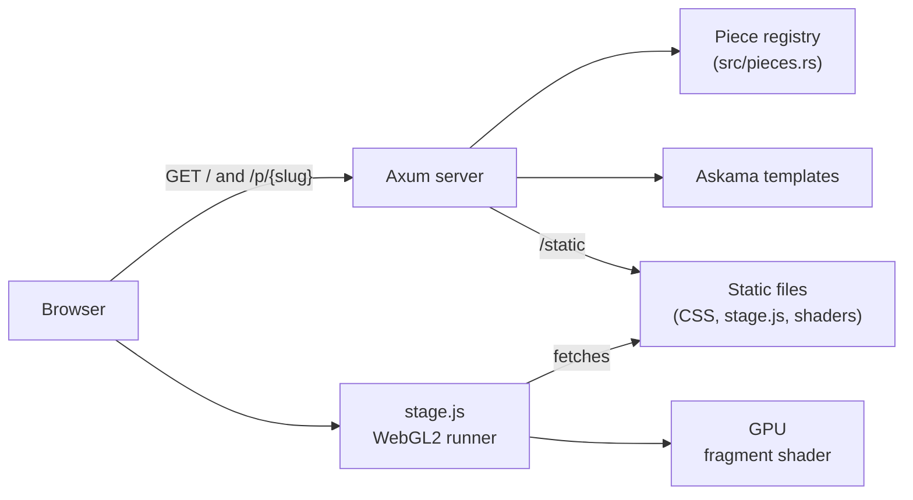

# Design showcase

Some of the nicest interfaces today pair clean, precise digital surfaces with something older: a
gradient that moves like liquid, then looks as if it had been filmed on worn 35mm stock. This
repository collects small pieces built on that idea. Each piece is a single fragment shader, so
the look comes entirely from code, with no images, video or design files behind it.

The first piece, Fluid, on film, renders soft gradients that fold into each other like dye in
water and prints them through a subtle analog treatment of grain, gate weave and flicker.

Ready to try it? Jump to the [installation instructions](#installation).

## Features

### Fluid, on film

- Gradients come from gradient noise with only three octaves, domain-warped twice, so colors
  stay smooth and broad instead of turning into smoke.
- Five colors (paper, lilac, cobalt, lagoon and apricot) are blended in linear light, which
  keeps the transitions clean.
- Grain is regenerated at 24 frames per second, like a projector, and is strongest in the
  midtones, as on real film. It is smoothly interpolated, so it clumps like silver instead of
  buzzing like digital noise.
- The print adds gate weave, about 2 percent exposure flicker, a soft S-curve with lifted
  blacks, a split tone, a light vignette and the occasional speck of dust.
- A Film button (or the F key) dissolves the analog treatment in and out, so the clean and the
  filmed image can be compared live.

### The showcase

- Pages are rendered on the server, and one small script runs any piece's shader in WebGL2.
- Adding a piece takes one entry in a registry and one shader file.
- `?t=12.5` freezes time and `?film=0` starts with the film treatment off, which helps with
  stills and screenshots.
- There is no npm, no build step for the frontend and no JavaScript dependency.

## Tech stack



The server only renders pages and serves files, while all the visual work happens in one
full-screen fragment shader per piece. Every shader receives the same three uniforms:
`u_res`, `u_time` and `u_film`.

The server is written in Rust, the pieces in GLSL ES 3.0, and the runner in plain JavaScript.

- [Axum](https://github.com/tokio-rs/axum) for routing
- [Askama](https://github.com/askama-rs/askama) for compile-time templates
- [tower-http](https://github.com/tower-rs/tower-http) to serve static files
- [Tokio](https://tokio.rs) as the runtime

Clippy runs with the `pedantic` and `nursery` groups, and `unwrap`, `expect` and `panic` are
denied. Four route tests check that every piece has a page and a valid shader:

```sh
cargo test
cargo clippy --all-targets
```

## Roadmap

- More pieces that put sleek, modern visuals through retro or analog media.

## Installation

You need a recent Rust toolchain (edition 2024) and a browser with WebGL2.

```sh
git clone https://github.com/vdTwer/design-showcase.git
cd design-showcase
cargo run
```

Then open <http://127.0.0.1:3000>. Set `ADDR` to listen elsewhere, for example
`ADDR=0.0.0.0:8080 cargo run`. The server reads `static/` from the source tree, so run it from
a checkout.

### Adding a piece

1. Write a fragment shader that starts with `#version 300 es` and save it in
   `static/shaders/`.
2. Add an entry with its slug, title, blurb and shader file name to `PIECES` in
   `src/pieces.rs`.
3. Run `cargo test` and open `/p/<slug>`.

## License

No license has been chosen yet.
