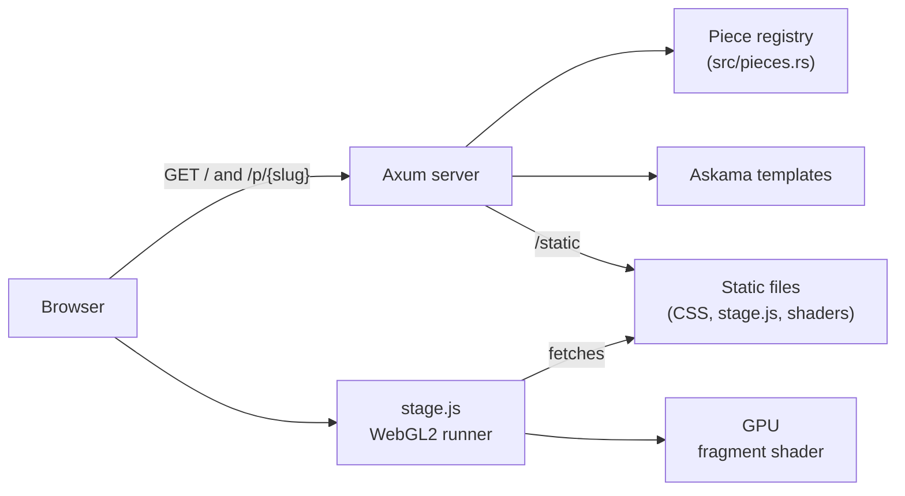

# Design showcase

Some of the nicest interfaces today pair clean, precise digital surfaces with something older: a
gradient that moves like liquid, then looks as if it had been filmed on worn 35mm stock. This
repository collects small pieces built on that idea. Each piece is a single fragment shader, so
the look comes entirely from code, with no images, video or design files behind it.

The first piece, Fluid, on film, renders soft gradients that fold into each other like dye in
water and prints them through a subtle analog treatment of grain, halation, gate weave and
flicker. Move the pointer across it, and the dye follows. The second piece, Colorways, pours
the same fluid into six cards, each built around a different primary color. The third, A week,
on paper, is a minimal, modern calendar mockup that washes unusual days in the fluid.

Ready to try it? Jump to the [installation instructions](#installation).

## Features

### Fluid, on film

- Gradients come from gradient noise with only three octaves, domain-warped twice, so colors
  stay smooth and broad instead of turning into smoke.
- Five colors (paper, lilac, cobalt, lagoon and apricot) are blended in linear light, which
  keeps the transitions clean.
- Grain is regenerated at 24 frames per second, like a projector, and is strongest in the
  midtones, as on real film. It is smoothly interpolated, so it clumps like silver instead of
  buzzing like digital noise.
- Moving the pointer or a finger stirs the fluid. The last 12 pointer samples push the dye
  along their velocity and swirl it around their path, and the wake heals within a few seconds.
- Halation gives highlights the warm red glow of real film, where light reflects off the film
  base and exposes the red layer a second time. A quarter-size pre-pass and its mipmap chain
  provide the wide blur in one extra draw call.
- The print also adds gate weave, about 2 percent exposure flicker, a soft S-curve with lifted
  blacks, a split tone, a light vignette and the occasional speck of dust.
- A Film button (or the F key) dissolves the analog treatment in and out, so the clean and the
  filmed image can be compared live.

### Colorways

- Six cards (Cobalt, Vermilion, Emerald, Saffron, Magenta and Lagoon) run the same shader with
  their own five-color palette: base, soft, primary, accent and secondary.
- Each card starts at a different point in time, so no two show the same shapes, and each one
  can be stirred on its own.
- Labels sit on frosted glass, and one Film button switches the treatment on every card at once.

### A week, on paper

- Every mark carries information, in the spirit of Tufte. Hue encodes the calendar: cobalt for
  work, apricot for personal and lagoon for travel, softened from the fluid's own palette so the
  fills sit on the paper. A fluid-on-film wash marks days that differ from the rest, and red
  marks now.
- Shapes share one language: squircle corners (CSS `corner-shape: squircle`, round where a
  browser lacks it), a solid fill and a soft shadow, for events, all-day
  bars and undated items alike. Todos are the one outlined shape.
- Events sit flush left in their day and leave room on the right, so the free time stays
  visible and clickable.
- Overlapping events cascade like paper slips, as in Apple Calendar: a later event is indented
  and drawn on top of the ones still running.
- All-day items are bars across the days they cover, stacked into as few lanes as possible.
- Todos are points in time with a checkbox, never blocks, so they read differently from events
  at a glance. Done ones are checked and struck through.
- "Sometime this week" runs along the bottom of the full-width week, holding events and todos
  without a day.
- "Where am I now" is today's date in a red circle, a red now line, the time in the gutter and a
  ring around the current event.
- The toolbar offers Day, 3 Days, Week, Multiweek and Month.
- It is built to be used: the day headers and the hour gutter stay in view while the week
  scrolls, the page opens scrolled to now (and to today on a phone), past events recede, an
  event that a later one covers early gets a one-line header so its time stays visible, and
  every truncated slip has the full text as a tooltip.
- The layout is computed in Rust and covered by thirteen unit tests. It is a mockup: the controls
  look real but do nothing.

### The showcase

- Pages are rendered on the server, and one small script runs any piece's shader in WebGL2.
- The stage runs every `canvas[data-shader]` on a page, pauses canvases that are off screen, and
  passes `data-palette` colors to the shader as `u_palette`.
- Every piece gets the pointer trail for free, and any piece that declares a `u_scene` sampler
  gets the blurred pre-pass for glows, bloom or halation.
- Adding a piece takes one entry in a registry and one shader file.
- `?t=12.5` freezes time and `?film=0` starts with the film treatment off, which helps with
  stills and screenshots.
- There is no npm, no build step for the frontend and no JavaScript dependency.

## Tech stack



The server only renders pages and serves files, while all the visual work happens in one
full-screen fragment shader per piece. Every shader receives the same uniforms: `u_res`,
`u_time`, `u_film` and the pointer trail in `u_stir` and `u_stirAge`. A shader that declares
`u_scene` runs twice per frame, first with `u_pass` 0 into a small mipmapped texture, then with
`u_pass` 1 to the screen.

The server is written in Rust, the pieces in GLSL ES 3.0, and the runner in plain JavaScript.

- [Axum](https://github.com/tokio-rs/axum) for routing
- [Askama](https://github.com/askama-rs/askama) for compile-time templates
- [tower-http](https://github.com/tower-rs/tower-http) to serve static files
- [Tokio](https://tokio.rs) as the runtime

Clippy runs with the `pedantic` and `nursery` groups, and `unwrap`, `expect` and `panic` are
denied. Twenty tests cover the calendar layout and check that every piece has a page and a valid
shader, that card pieces render one canvas per card, that every palette holds valid hex colors,
and that the calendar shows each of its features:

```sh
cargo test
cargo clippy --all-targets
```

## Roadmap

- More pieces that put sleek, modern visuals through retro or analog media.

## Installation

You need a recent Rust toolchain (edition 2024) and a browser with WebGL2.

```sh
git clone https://github.com/vdTwer/design-showcase.git
cd design-showcase
cargo run
```

Then open <http://127.0.0.1:3000>. Set `ADDR` to listen elsewhere, for example
`ADDR=0.0.0.0:8080 cargo run`. The server reads `static/` from the source tree, so run it from
a checkout.

### Adding a piece

1. Write a fragment shader that starts with `#version 300 es` and save it in
   `static/shaders/`.
2. Add an entry with its slug, title, blurb and shader file name to `PIECES` in
   `src/pieces.rs`, with a `Layout`: `Fullscreen`, `Cards` with their palettes, or
   `Calendar` with a week.
3. Run `cargo test` and open `/p/<slug>`.

## License

No license has been chosen yet.
